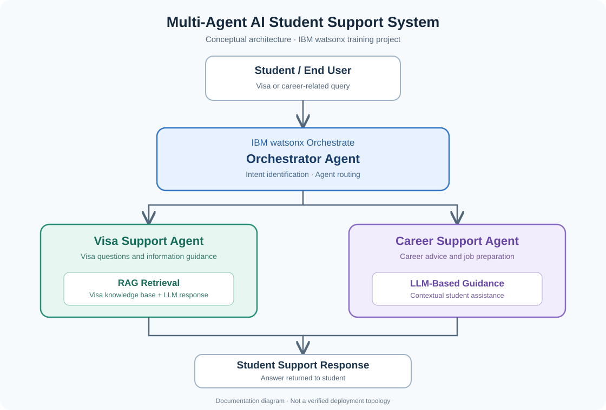

# Multi-Agent AI Student Support System using IBM watsonx

**IBM SkillsBuild Hackathon | Pace University | December 2025**  
**Achievement: 2nd Place**

> **Repository status:** Project documentation only. The original implementation was developed in a restricted training environment and its source code is not currently accessible. An independent implementation may be added later.

## Overview

This project explored a multi-agent AI approach to supporting students with visa-related questions and career guidance. An orchestrator routes a student's request to a specialised support agent, enabling a focused response.

## System Architecture

*Figure 1. Conceptual architecture reconstructed from the original project description; not an export of the original watsonx environment.*

## Agents

| Component | Responsibility |
| --- | --- |
| **Orchestrator Agent** | Understands student intent and routes requests to the relevant agent. |
| **Visa Support Agent** | Uses retrieval-augmented generation (RAG) to provide contextual answers from a visa-information knowledge base. |
| **Career Support Agent** | Provides career guidance and job-preparation support. |

## Example Interaction Flow

1. A student submits a visa or career-related question.
2. The orchestrator identifies the intent and selects an agent.
3. The selected agent prepares an answer; the visa agent uses retrieval from a knowledge base.
4. The answer is returned to the student.

## Technologies and Concepts

- IBM watsonx / watsonx Orchestrate (original training context)
- Multi-agent AI orchestration
- Large language models (LLMs)
- Retrieval-augmented generation (RAG)
- Natural-language query routing

## Recognition

**2nd Place — IBM SkillsBuild Hackathon, Pace University (December 2025).**

## Availability and Future Work

The original source code and training environment are not available for public release. This repository currently provides architecture and project documentation, not a runnable application.

Potential future work includes independently rebuilding the orchestrator and specialised agents, implementing retrieval, adding an interface, and providing reproducible setup and evaluation instructions.

## Disclaimer

This is a personal project documentation repository, not an official IBM or Pace University repository. The architecture diagram is conceptual and should not be interpreted as a verified export of the original deployment. Visa information supplied by any future implementation should be checked against official sources and should not be treated as legal advice.
